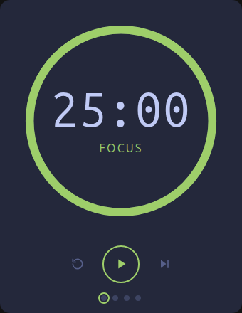
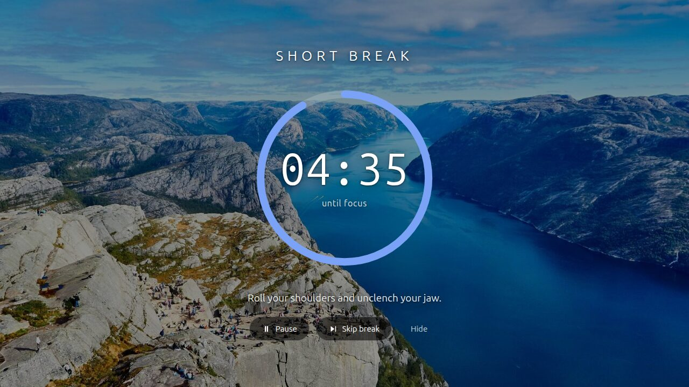

# Focal

A small focus timer for Linux that stays on top of your other windows. Work in focus rounds, and when one ends a full-screen break screen reminds you to step away.

<p>
  
  &nbsp;
  
</p>

## Install

**Ubuntu, Debian, Linux Mint, Pop!_OS**

```sh
wget https://github.com/divinesta/focal/releases/latest/download/focal_amd64.deb
sudo apt install ./focal_amd64.deb
```

Then open **Focal** from your app menu.

**Any other Linux (AppImage)**

```sh
wget https://github.com/divinesta/focal/releases/latest/download/focal_amd64.AppImage
chmod +x focal_amd64.AppImage
./focal_amd64.AppImage
```

**Uninstall:** `sudo apt remove focal`

## Features

- **Always on top**, including on GNOME Wayland, where most apps can't do this
- Focus, short break and long break rounds, with focus blocks up to 4 hours
- **Full-screen break screen** with photo backgrounds, or add your own pictures
- Countdown in the system tray, desktop notifications, sounds
- 14 themes, custom ring colours and gradients, see-through background
- Shrinks down to a tiny ring, and the title bar hides when you're not using it
- The timer survives quitting and restarting
- Keyboard shortcuts: `Space` start/pause, `S` skip, `R` restart, `B` show break screen

## Performance

Measured on Ubuntu 26.04 (Intel laptop), Focal 0.4.1:

| | Timer paused | Timer running |
|---|---|---|
| Memory (PSS, all processes) | ~158 MB | ~164 MB |
| CPU (share of one core) | ~0.03% | ~1.1% |
| Download size (`.deb`) | 6.5 MB | |

Most of the memory is WebKitGTK, the web engine Linux uses to draw the window. Focal's own code is a small part of it.

## Build from source

You need [Rust](https://rustup.rs), [Bun](https://bun.sh) and the Tauri system libraries:

```sh
sudo apt install libwebkit2gtk-4.1-dev libayatana-appindicator3-dev librsvg2-dev libxdo-dev libssl-dev
bun install
bun tauri dev      # run with hot reload
bun tauri build    # installers end up in src-tauri/target/release/bundle/
```

Built with [Tauri 2](https://tauri.app) and React.

Background photos are from [Unsplash](https://unsplash.com), via [Lorem Picsum](https://picsum.photos), under the Unsplash License.
